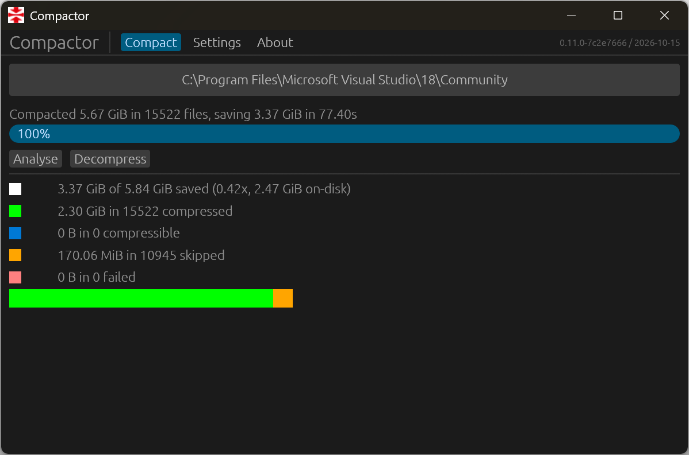

# Compactor

> [!CAUTION]
> This is an LLM-commanded rewrite of Thomas Hurst's [Compactor], in a desperate want for modern dependencies and Rust conventions.  There is a probability that you may destroy your computer if you somehow end up using this (though Thomas' original version may too).  Too bad!

## A friendly user interface for Windows filesystem compression

With modern lightweight compression algorithms running at gigabytes per second per core, it's practically a no-brainer to apply them to filesystems to make better use of storage and IO.

Half-recognising this, Windows 2000 (then improved in 10) shipped with a compression system that, while fast and effective, is only exposed to users via a command-line tool&mdash;[`compact.exe`].

Compactor is here to plug that gap, with a simple GUI utility anyone can use.

## Features

### Real-time Progress Updates

Compactor's directory analysis updates as it goes.  You too can experience the satisfaction of watching the disk-space used counter tick down with each file compressed.

### Pause, Resume, Stop

All operations can be paused and interrupted safely at any time.  Compactor will finish off what it's doing and stop, or restart where it left off.

### Compresstimation

Compactor performs a statistical compressibility check on larger files before passing them off to Windows for compaction.  A large incompressible file can be skipped in less than a second instead of tying up your disk for minutes for zero benefit.

### Machine Learning

Using hyper-advanced AI-powered hashtable technology, Compactor can skip over files that have been previously found to be incompressible, making re-running Compactor on a previously compressed folder much quicker.  Hopefully.

### Scalable and Fast

Written in [Rust], a modern compiled systems programming language (not C), Compactor can probably cope with large folders containing millions (or even billions!) of files, provided that neither `compact.exe`, NTFS, or your drive shit the bed.

## Caveats

### Terminally Beta Software

While it has been used successfully by the author, Compactor should be used with care (if you value your time).  It is intended for compressing replacable software, not precious files.

### Data Corruption

What? No, you're insane&mdash; that would *never* hapen, surely...

### Permissions

Freaky didn't implement a mechanism to elevate Compactor's privileges for protected files, and I won't either.  If you're using a limited account, you may need to run the program with elevated permissions.

Be careful what you compress.  System files will be skipped automatically, and the Windows folder should be in the list of default exclusions (if you want to compact Windows, check out its [CompactOS] feature), but you almost certainly don't want to blindly run this across your entire `C:\` drive.

### Modifiable Files

Compaction is designed for **files that rarely change**&mdash;any modifications result in the file being uncompressed in its entirety.  In fact, simply opening a file in write mode will *hang* until the file is uncompressed, even if no changes are made.

This generally doesn't matter much for application folders, but it's not great for databases, logs, virtual machine images, and various other things that *hopefully* mostly live elsewhere.

If a game uses large files and in-place binary patching for updates, it might be worth adding to the exclusions list.

### Compatibility with Other Operating Systems

Compaction is only supported on Windows ≥10.  Earlier versions of Windows will be unable to access compressed files, though the rest of the filesystem should remain fully accessible.

Linux, \*BSD, and other godless operating systems with NTFS drivers may experience issues if you attempt to access files compressed by this tool.

## Nerdy Technical Stuff

Compactor is primarily written in [Rust].  The front end is built with [egui] and [eframe].  It does *not* depend on any remote resources or open any ports.

Under the hood it uses [`DeviceIoControl`] with [`FSCTL_SET_EXTERNAL_BACKING`] and [`FSCTL_DELETE_EXTERNAL_BACKING`], and a few functions from [WofApi] (Windows Overlay Filesystem), via the [windows-sys] crate.  Physical sizes come from `GetCompressedFileSizeW`.  Only files backed by WOF are treated as compressed and offered for decompression, as legacy compression and sparse files can't be undone through its API.

Compresstimation uses a simple linear sampling algorithm, passing blocks through LZ4 level 1 as a compressibility check and averaging across the entire file.  The code is [available on Github][compresstimator].

The incompressible-files database is simply an append-only list of SipHash128 path hashes, being lower-cased before hashing.  It lives in `%LOCALAPPDATA%\Freaky\Compactor\cache\incompressible.dat`, with saved settings in `%APPDATA%\Freaky\Compactor\config\config.json`.

## Author

Compactor was written by [Thomas Hurst], a nerdy, aloof weirdo from the north-east of England, and a programmer for about how-many-years.

This fork was vibe-shat out by [Cirqup], a perilous scamp from a bog in North America, and a programmer of 7 years.

[Cirqup]: https://github.com/crqp
[CompactOS]: https://technet.microsoft.com/en-us/windows/dn940129(v=vs.60)
[Compactor]: https://github.com/Freaky/Compactor
[Rust]: https://www.rust-lang.org/
[Thomas Hurst]: https://hur.st/
[WofApi]: https://docs.microsoft.com/en-us/windows/desktop/api/wofapi/
[`DeviceIoControl`]: https://docs.microsoft.com/en-us/windows/desktop/api/ioapiset/nf-ioapiset-deviceiocontrol
[`FSCTL_DELETE_EXTERNAL_BACKING`]: https://docs.microsoft.com/en-us/windows-hardware/drivers/ifs/fsctl-delete-external-backing
[`FSCTL_SET_EXTERNAL_BACKING`]: https://docs.microsoft.com/en-us/windows-hardware/drivers/ifs/fsctl-set-external-backing
[`compact.exe`]: https://docs.microsoft.com/en-us/windows-server/administration/windows-commands/compact
[compresstimator]: https://github.com/Freaky/compresstimator
[eframe]: https://github.com/emilk/egui/tree/main/crates/eframe
[egui]: https://egui.rs/
[windows-sys]: https://github.com/microsoft/windows-rs
